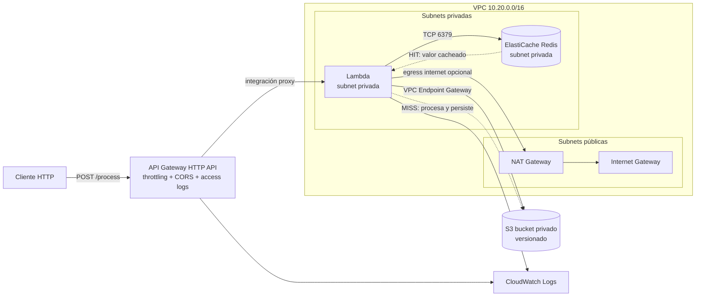

# Servicio Serverless de Procesamiento con Caché — Prueba Técnica SRE

Infraestructura base para un servicio de procesamiento de datos serverless en AWS, desplegable por completo con Terraform y validable en LocalStack sin costo. El servicio recibe solicitudes HTTP, las procesa en Lambda, usa ElastiCache Redis como caché para evitar reprocesamiento y persiste los resultados en S3.

> **Estado:** Entrega completa. Stack desplegado y validado en LocalStack con evidencias de MISS/HIT y persistencia en S3. Ver [Estado de la entrega](#0-estado-de-la-entrega).

---

## 0. Estado de la entrega

Entrega completa: diseño, infraestructura como código, código de la Lambda, documentación técnica, despliegue validado en LocalStack y evidencias de funcionamiento.

| Área | Estado | Detalle |
| --- | --- | --- |
| Diseño y arquitectura | ✅ Completo | `docs/01-diseno.md`, diagramas, CIDRs, naming |
| Matriz de requerimientos | ✅ Completo | `docs/06-matriz-requerimientos.md` |
| IaC — Red | ✅ Completo | `terraform/vpc.tf`, `security.tf` |
| IaC — Servicios | ✅ Completo | `terraform/{s3,redis,lambda,apigw}.tf` |
| Código Lambda | ✅ Completo | `lambda/handler.py` |
| Modelo de seguridad | ✅ Completo | `docs/02-seguridad.md` |
| Observabilidad | ✅ Completo | `docs/03-monitoreo.md` |
| Validación desplegada (`apply` + `curl`) | ✅ Completo | Desplegado y probado en LocalStack |
| Evidencias MISS/HIT/S3 | ✅ Completo | Carpeta `evidence/` |
| Runbooks despliegue/rollback | ✅ Completo | `docs/04-*.md`, `docs/05-*.md` |

> **Nota de entorno:** la validación se realizó sobre LocalStack (edición gratuita). Por sus límites, Redis corre en un contenedor Docker (ElastiCache es Pro) y el API Gateway es REST v1 (HTTP API es Pro). El código Terraform es portable a AWS real con `use_elasticache = true` (ver `docs/04-runbook-despliegue.md` §4).

---

## 1. Resumen ejecutivo

El objetivo es desplegar, de forma 100% reproducible y segura, la base de un servicio serverless que expone un endpoint `POST /process`. Cada solicitud genera una clave de caché; si la clave existe en Redis se devuelve el resultado cacheado (cache **HIT**), y si no existe se procesa la solicitud, se guarda el resultado en S3, se escribe en Redis con TTL de 60 segundos y se devuelve el resultado (cache **MISS**). Toda respuesta incluye el header `X-Cache` indicando HIT o MISS.

La solución prioriza tres atributos: **reproducibilidad** (un solo `terraform apply`), **seguridad de red** (todo el cómputo en subnets privadas, S3 privado con acceso por VPC Endpoint) y **observabilidad** (logs de acceso de API Gateway y logs estructurados de Lambda en CloudWatch).

---

## 2. Alcance de la solución

**Incluido (requerido por el enunciado):**

- VPC dedicada con 2 subnets públicas y 2 privadas en dos zonas de disponibilidad.
- Internet Gateway, NAT Gateway y VPC Endpoint tipo Gateway para S3.
- Security Groups segmentados (Lambda ↔ Redis por el puerto 6379 únicamente).
- API Gateway HTTP API con ruta `POST /process`, integración proxy, throttling, CORS y access logs.
- Función Lambda en subnets privadas con lógica HIT/MISS, header `X-Cache` y manejo de errores (HTTP 500).
- ElastiCache Redis `cache.t3.micro` en subnets privadas con Subnet Group y TTL de 60s.
- Bucket S3 privado (Block Public Access x4), versionado, prefijo `results/<fecha>/<id>.json` y bucket policy restringida al rol de Lambda.
- Roles IAM de mínimo privilegio.

**Excluido (no exigido; se documenta como opcional):**

- Pipeline CI/CD multi-stage con aprobación manual.
- Remote state (S3 + DynamoDB lock).
- KMS / Secrets Manager (Redis sin autenticación no los requiere).
- Dashboards y alarmas de CloudWatch.
- Separación de ambientes dev/prod más allá de la parametrización por variables.

---

## 3. Arquitectura



### 3.1 Capas

| Capa | Componente | Ubicación |
| --- | --- | --- |
| Entrada | API Gateway HTTP API | Regional (público) |
| Procesamiento | Lambda + IAM Role | Subnets privadas |
| Caché | ElastiCache Redis | Subnets privadas |
| Persistencia | S3 (privado, versionado) | Regional, acceso por VPC Endpoint |
| Red | VPC, IGW, NAT GW, VPC Endpoint, Route Tables | — |
| Observabilidad | CloudWatch Logs | — |

---

## 4. Flujo end-to-end

```
Cliente -> API Gateway (POST /process) -> Lambda (VPC privada)
    -> genera cache key (hash del body)
    -> consulta Redis
        -> HIT  : retorna valor cacheado + X-Cache: HIT
        -> MISS : procesa -> guarda en S3 (results/<fecha>/<id>.json)
                  -> escribe en Redis TTL=60s -> X-Cache: MISS
```

Para demostrar el funcionamiento se envían dos requests idénticos consecutivos: el primero devuelve `X-Cache: MISS` y el segundo `X-Cache: HIT`.

---

## 5. Estructura del repositorio

```
proyecto/
├── README.md                     # este documento
├── docs/
│   ├── 01-diseno.md              # diseño técnico detallado          ✅
│   ├── 02-seguridad.md           # modelo de seguridad               ✅
│   ├── 03-monitoreo.md           # observabilidad                    ✅
│   ├── 04-runbook-despliegue.md  # runbook de despliegue             ✅
│   ├── 05-runbook-rollback.md    # runbook de rollback               ✅
│   └── 06-matriz-requerimientos.md                                   ✅
├── terraform/                    # IaC (estructura plana: un .tf por componente)
│   ├── providers.tf              # providers y versiones
│   ├── variables.tf              # variables parametrizables
│   ├── vpc.tf                    # VPC, subnets, IGW, NAT, route tables, endpoint S3
│   ├── security.tf               # Security Groups (Lambda, Redis)
│   ├── s3.tf                     # bucket + BPA + versioning + policy
│   ├── redis.tf                  # ElastiCache + subnet group
│   ├── lambda.tf                 # función + IAM role + log group
│   ├── apigw.tf                  # HTTP API + ruta + throttling + CORS + logs
│   ├── outputs.tf                # endpoint API, bucket, redis, etc.
│   └── terraform.tfvars          # valores de las variables
├── lambda/
│   └── handler.py                # código de la función              ✅
└── evidence/                     # evidencias MISS/HIT/S3 + logs      ✅
    ├── 01-miss.txt
    ├── 02-hit.txt
    ├── 03-s3-objetos.txt
    ├── 04-logs-lambda.txt
    ├── 05-terraform-outputs.txt
    ├── capturas/
    └── README.md
```

---

## 6. Prerrequisitos

| Herramienta | Versión sugerida | Uso |
| --- | --- | --- |
| Terraform | >= 1.6 | IaC |
| AWS CLI | >= 2.x | Interacción con AWS/LocalStack |
| Docker | >= 24 | Ejecutar LocalStack |
| LocalStack | >= 3.x | Emular AWS en local |
| tflocal / awslocal | última | Wrappers de Terraform/CLI para LocalStack |
| Python | >= 3.11 | Runtime Lambda y notebook |
| Permisos AWS | — | Solo si se despliega en AWS real |

> Si se despliega en AWS real, se requieren credenciales con permisos para VPC, API Gateway, Lambda, ElastiCache, S3 e IAM. Recordar que NAT Gateway y Redis generan costo por hora.

---

## 7. Despliegue

> Los comandos finales se fijarán en la Fase 2. Flujo previsto:

```bash
# 1. Levantar LocalStack
localstack start -d

# 2. Empaquetar la Lambda
cd lambda && zip ../terraform/lambda.zip handler.py && cd ..

# 3. Desplegar con un solo apply (tflocal = Terraform apuntando a LocalStack)
cd terraform
tflocal init
tflocal plan
tflocal apply -auto-approve
```

En AWS real se sustituye `tflocal` por `terraform` y se configuran credenciales estándar.

---

## 8. Validaciones funcionales

```bash
API_URL=$(tflocal output -raw api_endpoint)

# Primera llamada: MISS
curl -i -X POST "$API_URL/process" -H "Content-Type: application/json" -d '{"data":"hola"}'
# Esperado: HTTP 200 + header "X-Cache: MISS"

# Segunda llamada idéntica: HIT
curl -i -X POST "$API_URL/process" -H "Content-Type: application/json" -d '{"data":"hola"}'
# Esperado: HTTP 200 + header "X-Cache: HIT"

# Verificar objeto en S3
awslocal s3 ls "s3://$(tflocal output -raw s3_bucket_name)/results/" --recursive
```

---

## 9. Outputs de Terraform

| Output | Descripción |
| --- | --- |
| `api_endpoint` | URL base del API Gateway |
| `s3_bucket_name` | Nombre del bucket de resultados |
| `redis_endpoint` | Endpoint del nodo Redis |
| `lambda_function_name` | Nombre de la función Lambda |
| `vpc_id` | ID de la VPC creada |

---

## 10. Troubleshooting

| Síntoma | Causa probable | Acción |
| --- | --- | --- |
| Lambda no conecta a Redis | SG mal configurado o Lambda fuera de la subnet privada | Verificar reglas SG (6379) y asignación de subnets |
| `curl` da 500 siempre | Error en el handler o Redis no disponible | Revisar logs en CloudWatch (`/aws/lambda/...`) |
| S3 inaccesible desde Lambda | VPC Endpoint ausente o ruta faltante | Validar VPC Endpoint Gateway y route tables privadas |
| ElastiCache no levanta en LocalStack | Soporte parcial en Community | Plan B: Redis en contenedor Docker |
| `X-Cache` nunca es HIT | TTL expirado o key distinta | Confirmar misma entrada y TTL de 60s |

---

## 11. Decisiones técnicas

| Decisión | Opción elegida | Justificación |
| --- | --- | --- |
| Tipo de API Gateway | **REST API (v1)** | Se eligió REST API porque la edición gratuita de LocalStack no soporta HTTP API (apigatewayv2). REST API cumple los mismos requisitos (proxy, throttling rate+burst, CORS, access logs). En AWS real cualquiera de las dos sería válida; HTTP API sería preferible por costo/latencia si no hubiera restricción de entorno |
| Lenguaje Lambda | **Python 3.11** | Librerías `redis` y `boto3` maduras, handler legible, arranque rápido |
| Tipo de nodo Redis | **cache.t3.micro** | Nodo más económico que admite el enunciado |
| Entorno de validación | **LocalStack** | Sin costo, iteración rápida, código portable a AWS real |
| Acceso a S3 | **VPC Endpoint Gateway** | Evita salida a internet y cumple el requisito de red privada |
| Estado de Terraform | **Local** (LocalStack) | Remote state es opcional; se documenta como mejora para AWS real |

---

## 12. Consideraciones de seguridad

- **Red:** Lambda y Redis solo en subnets privadas, sin IP pública. Redis acepta tráfico únicamente desde el SG de Lambda en el puerto 6379.
- **S3:** Block Public Access en las 4 configuraciones, versionado y bucket policy que restringe el acceso al rol IAM de la Lambda.
- **IAM:** rol de Lambda con permisos mínimos (escritura en el prefijo `results/*`, logs y gestión de ENI para VPC).
- **Secrets:** sin credenciales en el código ni en los `.tf`. Redis sin autenticación no requiere secret; si se añadiera, se usaría Parameter Store / Secrets Manager.
- **Egress controlado:** salida a internet solo vía NAT Gateway cuando sea estrictamente necesaria.

El detalle completo del modelo de seguridad se desarrolla en `docs/02-seguridad.md` (fase posterior).
