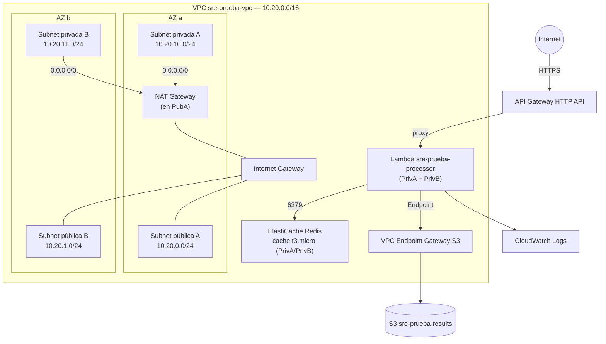

# 01 — Diseño Técnico Detallado

> Documento de diseño de referencia. El IaC de la Fase 2 debe implementar exactamente lo definido aquí. Cualquier cambio de infraestructura se valida contra este documento.

---

## 1. Diagrama lógico

---

## 2. Diseño de red

### 2.1 CIDR

| Elemento | CIDR | Notas |
| --- | --- | --- |
| VPC | `10.20.0.0/16` | 65.536 IPs, holgura para crecer |
| Subnet pública A | `10.20.0.0/24` | AZ `a` — NAT, IGW |
| Subnet pública B | `10.20.1.0/24` | AZ `b` — alta disponibilidad de entrada |
| Subnet privada A | `10.20.10.0/24` | AZ `a` — Lambda, Redis |
| Subnet privada B | `10.20.11.0/24` | AZ `b` — Lambda, Redis |

Rango `10.20.x.x` elegido para no colisionar con VPCs por defecto (`172.31.x.x`) ni con redes domésticas comunes (`192.168.x.x`).

### 2.2 Subnets públicas y privadas

| Subnet | Tipo | AZ | Recursos | Ruta a internet |
| --- | --- | --- | --- | --- |
| `sre-prueba-public-a` | Pública | a | NAT Gateway | Directa vía IGW |
| `sre-prueba-public-b` | Pública | b | (reserva HA) | Directa vía IGW |
| `sre-prueba-private-a` | Privada | a | Lambda ENI, Redis | Vía NAT (saliente) |
| `sre-prueba-private-b` | Privada | b | Lambda ENI, Redis | Vía NAT (saliente) |

Lambda y Redis se despliegan en **ambas** subnets privadas para tolerancia a fallo de una AZ.

### 2.3 Routing

| Route Table | Asociada a | Rutas |
| --- | --- | --- |
| `sre-prueba-rt-public` | Subnets públicas A y B | `10.20.0.0/16` local; `0.0.0.0/0` → IGW |
| `sre-prueba-rt-private` | Subnets privadas A y B | `10.20.0.0/16` local; `0.0.0.0/0` → NAT GW; prefix list S3 → VPC Endpoint |

El VPC Endpoint Gateway para S3 inyecta automáticamente la ruta hacia la prefix list de S3 en la route table privada, de modo que el tráfico a S3 **no** sale por el NAT ni por internet.

### 2.4 NAT Gateway

- Un solo NAT Gateway en `sre-prueba-public-a` (suficiente para la prueba; en producción se recomienda uno por AZ).
- Proporciona salida a internet únicamente para tráfico saliente de Lambda que no sea hacia S3 (p. ej. futuras dependencias externas).
- Requiere una Elastic IP asociada.

> **Nota de costo (AWS real):** el NAT Gateway cobra por hora y por GB procesado. En LocalStack no genera costo. Si se usa AWS real, destruir con `terraform destroy` tras capturar evidencias.

---

## 3. Diseño de componentes

### 3.1 API Gateway

| Atributo | Valor |
| --- | --- |
| Tipo | HTTP API |
| Ruta | `POST /process` |
| Integración | Proxy (AWS_PROXY) a Lambda |
| CORS | Habilitado para cualquier origen (`*`) |
| Throttling | Rate limit y burst a nivel de stage (ej. rate 50 req/s, burst 100) |
| Stage | `$default` con auto-deploy |
| Access logs | CloudWatch log group dedicado, formato JSON |

**Justificación HTTP API vs REST API:** HTTP API cubre proxy, CORS, throttling y access logs con menor costo y latencia. REST API solo sería necesario para API keys, usage plans o validación de request/response avanzada, que no pide el enunciado.

### 3.2 Lambda

| Atributo | Valor |
| --- | --- |
| Nombre | `sre-prueba-processor` |
| Runtime | Python 3.11 |
| Red | VPC, subnets privadas A y B |
| Variables de entorno | `REDIS_HOST`, `REDIS_PORT`, `S3_BUCKET`, `CACHE_TTL=60` |
| Timeout | 10s |
| Memoria | 256 MB |
| Concurrencia | Según demanda (escalado automático) |

Responsabilidades del handler:
1. Parsear el body del request.
2. Generar cache key determinística (hash SHA-256 del body normalizado).
3. Consultar Redis → HIT devuelve valor + `X-Cache: HIT`.
4. MISS: procesar (transformación libre), guardar en S3 (`results/<fecha>/<id>.json`), escribir en Redis con TTL 60s, devolver `X-Cache: MISS`.
5. Cualquier excepción → HTTP 500 con mensaje descriptivo + log estructurado en CloudWatch.

### 3.3 Redis (ElastiCache)

| Atributo | Valor |
| --- | --- |
| Motor | Redis |
| Tipo de nodo | `cache.t3.micro` |
| Nodos | 1 (sin réplica; suficiente para la prueba) |
| Subnet Group | `sre-prueba-redis-subnets` → subnets privadas A y B |
| Puerto | 6379 |
| Acceso | Solo desde SG de Lambda |
| TTL de keys | 60s explícito en cada escritura |
| Persistencia | Sin persistencia indefinida (solo caché con TTL) |

### 3.4 S3

| Atributo | Valor |
| --- | --- |
| Nombre | `sre-prueba-results-<sufijo-único>` |
| Block Public Access | Las 4 configuraciones habilitadas |
| Versionado | Habilitado |
| Estructura de objetos | `results/<YYYY-MM-DD>/<id>.json` |
| Bucket policy | Acceso restringido al rol IAM de la Lambda |
| Acceso de red | Vía VPC Endpoint Gateway |
| Cifrado | SSE-S3 por defecto (SSE-KMS opcional) |

---

## 4. Consideraciones de escalabilidad

- **Lambda:** escala horizontalmente de forma automática según invocaciones concurrentes. El límite práctico es la concurrencia de la cuenta y las conexiones a Redis.
- **API Gateway:** HTTP API escala de forma gestionada; el throttling protege a Redis y Lambda de picos.
- **Redis:** `cache.t3.micro` es suficiente para la prueba; en producción se escalaría verticalmente (nodo mayor) o a modo cluster con réplicas.
- **S3:** escala de forma transparente; el prefijo por fecha ayuda a distribuir la carga de escritura.
- **Conexiones Redis:** con alta concurrencia de Lambda conviene reutilizar conexiones (cliente fuera del handler) para no agotar conexiones del nodo.

---

## 5. Consideraciones de resiliencia

- **Multi-AZ en red:** subnets públicas y privadas en dos AZ; Lambda y Redis distribuidos en ambas.
- **Punto único actual:** un solo NAT Gateway y un solo nodo Redis (aceptable para la prueba, documentado como mejora: NAT por AZ y Redis con réplica).
- **Degradación controlada:** si Redis no responde, el handler debe poder procesar y persistir en S3 igualmente (fallar abierto hacia el procesamiento), registrando el error — decisión a validar en implementación.
- **Idempotencia:** la cache key determinística evita duplicar procesamiento para la misma entrada.
- **Versionado S3:** protege contra sobrescritura accidental de resultados.

---

## 6. Convención de nombres (naming)

Formato: `sre-prueba-<componente>[-<sufijo>]`

| Recurso | Nombre |
| --- | --- |
| VPC | `sre-prueba-vpc` |
| Subnets públicas | `sre-prueba-public-a`, `sre-prueba-public-b` |
| Subnets privadas | `sre-prueba-private-a`, `sre-prueba-private-b` |
| Internet Gateway | `sre-prueba-igw` |
| NAT Gateway | `sre-prueba-nat` |
| Route tables | `sre-prueba-rt-public`, `sre-prueba-rt-private` |
| VPC Endpoint | `sre-prueba-vpce-s3` |
| SG Lambda | `sre-prueba-sg-lambda` |
| SG Redis | `sre-prueba-sg-redis` |
| Lambda | `sre-prueba-processor` |
| Rol IAM Lambda | `sre-prueba-lambda-role` |
| Redis | `sre-prueba-redis` |
| Subnet Group Redis | `sre-prueba-redis-subnets` |
| Bucket S3 | `sre-prueba-results-<sufijo-único>` |
| API Gateway | `sre-prueba-api` |
| Log group API | `/aws/apigw/sre-prueba-api` |
| Log group Lambda | `/aws/lambda/sre-prueba-processor` |

**Tags comunes** aplicados a todos los recursos:

| Tag | Valor |
| --- | --- |
| `Project` | `sre-prueba` |
| `Environment` | `dev` |
| `ManagedBy` | `terraform` |
| `Owner` | `<responsable>` |
